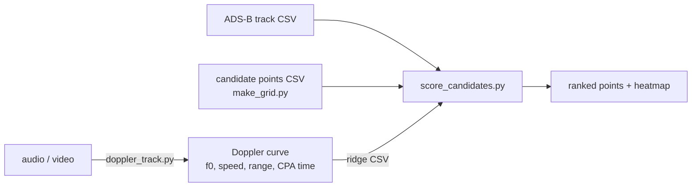
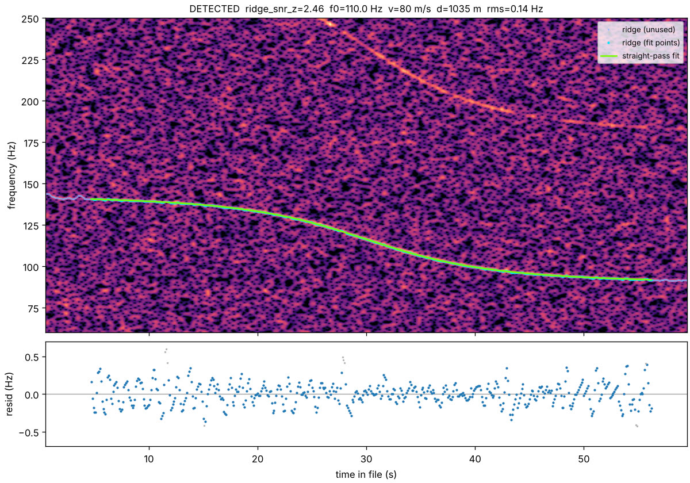
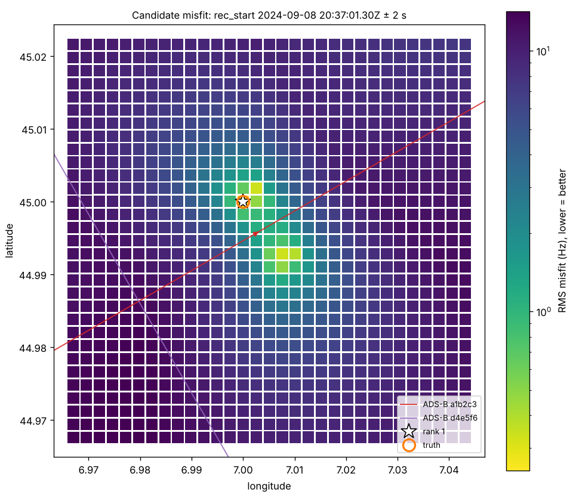
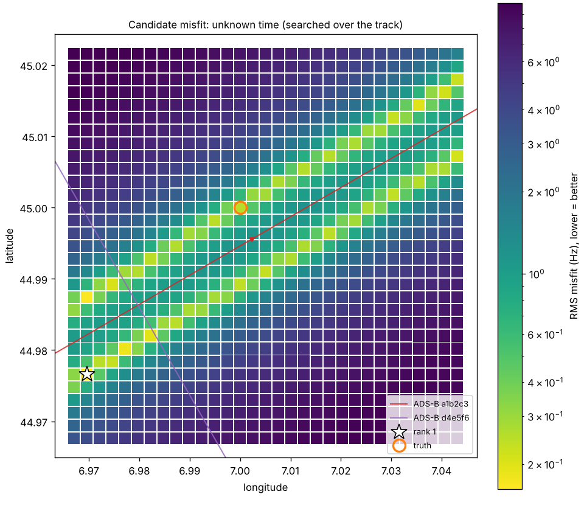

# Aircraft Doppler geolocation

Estimate where (and roughly when) a recording was made from the hum of a passing aircraft.

A plane's engine tone drops in pitch as it flies past (the Doppler effect). The exact shape of that drop
depends on the plane's speed, how close it came, and when it was closest. Public ADS-B flight tracks give
every aircraft's position second by second, so each candidate spot on the ground predicts a specific curve.
The spot whose predicted curve matches the recording is where the microphone was.

The method comes from the YouTube video *"I discovered a sound that leaks your exact location"* by
**colsto** (@colsto_). He did not release code. This directory is an independent implementation written from
the physics. It follows the same three-script layout as the
[aircraft-doppler-geolocation](https://hermes-agent.nousresearch.com/docs/plugins/aircraft-doppler-geolocation)
Hermes plugin, which is another independent take.



## Web app (`web/`)

A single-page version that runs entirely in the browser, with its own JavaScript engine (`web/engine.js`).
It fixes the gaps in the Python CLI below:

| Gap in the CLI | What the web engine does |
|---|---|
| You pick the band by eye | Searches every band automatically (log-spaced Viterbi ridges), then re-collects points along each fitted curve over the whole clip. A drag-box on the spectrogram adds a missed flyover by hand. |
| Narrow detection margin | Matched-curve score, checked against the same search run on the time-reversed spectrogram. A real flyover only ever falls in pitch, so that run measures what noise alone can produce. |
| One pass, no timestamp, gives a line | All selected flyovers are solved together on one shared clock, so two passes pin a point without a timestamp. |
| Ambiguity hidden in a ranking | A 95% confidence region is computed on a refined sub-grid and split into separate areas (mirror solutions, valleys). The verdict says which case you are in. |
| Crossing harmonics break the tracker | Fragments are merged. Ridges are attributed to a parent pass by harmonic ratio, and ridges stitched across crossings are dropped. |
| Optimistic error bars | Errors are inflated by the residuals' full autocorrelation. Each pass counts as at most ~10 independent measurements when sizing the region. |
| Still air at 343 m/s | Speed of sound comes from air temperature, and wind enters the Doppler and travel-time model. |
| CSV only | Reads OpenSky/FR24/generic CSV, readsb/tar1090 trace JSON (adsb.lol, ADS-B Exchange), OpenSky track JSON, KML and .gz. Sparse tracks are interpolated with reported speed and heading. |

```bash
cd web
node test_engine.js 7     # headless end-to-end test of the engine (two flyovers, unknown time, noise-only clip)
node build.js             # inlines engine.js into app.html -> dist/flyover-locator.html
```

The page cannot download flight data itself, because the artifact sandbox blocks network requests. It links
to replay maps for the area and time instead. It is still only tested on synthetic recordings.

## What's here (Python CLI)

| Script | Job |
|---|---|
| `doppler_track.py` | Decodes audio with ffmpeg, builds a narrow-band spectrogram, traces the tone with a Viterbi ridge tracker, and fits a straight-pass Doppler model (base tone, speed, closest-approach slant range and time). It also runs a detection guard. |
| `score_candidates.py` | For each candidate point, predicts the exact curve that point would have heard from the ADS-B track, using the aircraft's velocity *at emission time*. It searches the recording start time and ranks the points by misfit in Hz. Writes a CSV and an optional heatmap. |
| `make_grid.py` | Writes a square grid of candidate points (constant ground elevation). |
| `make_synthetic_test.py` | Offline end-to-end test. It synthesises a flyover in noise plus matching ADS-B, runs the real CLIs, and checks the answers. |
| `doppler_common.py` | Shared physics, WGS84 geodesy and I/O. |

## Quick start

```bash
pip install -r requirements.txt        # plus ffmpeg on PATH (soundfile fallback reads wav/flac)
python make_synthetic_test.py          # writes synthetic_out/, exit 0 = all checks pass
```

On real data:

```bash
# 1. look at a spectrogram, find a tone sliding downward, pick the band and window
python doppler_track.py clip.mp4 --fmin 60 --fmax 250 --start 12 --end 75 --out ev1
#    -> ev1.csv (ridge points), ev1.json (fit + detection), ev1.png (check it!)

# 2. candidate points (or bring your own lat,lon,elev_m CSV with DEM elevations)
python make_grid.py --center 51.50,-0.12 --radius 5000 --step 200 --elev 20 --out candidates.csv

# 3. score against ADS-B for the right place and time
python score_candidates.py track.csv candidates.csv ev1.csv \
    --rec-start 1725827820 --dt-tol 2 --plot scores.png
```

**ADS-B data.** The scripts do not fetch any. Export tracks yourself from
[OpenSky](https://opensky-network.org/) (`pyopensky`, `traffic`), [adsb.lol](https://adsb.lol) or ADS-B
Exchange. The CSV needs `time` (unix s/ms or ISO-8601), `lat`, `lon` and an altitude column. Optionally add
`icao24`/`hex`/`callsign` to score several aircraft at once. Each candidate keeps its best-matching aircraft.

**Altitude units matter.** `geoaltitude`, `baroaltitude` and `alt_m` are read as metres. `alt_geom`,
`alt_baro`, `altitude` and `alt_ft` are read as feet. The `traffic` library reports `geoaltitude` in feet, so
pass `--alt-units ft` for its exports. Geometric altitude is better than barometric, which can be off by tens of
metres. Candidate `elev_m` should use the same vertical datum as the track's altitude.

## The physics

For a source moving in a straight line at speed *v* that is closest to the observer (slant range *d*) at
emission time *t*<sub>ca</sub>, with sound speed *c*:

- Emission time *τ* (relative to *t*<sub>ca</sub>) for receive time *T*: solve
  *T − τ = √(d² + v²τ²) / c*. This is a quadratic with one causal root, so no iteration is needed.
- Received frequency: *f = f₀ / (1 + v²τ / (c·r))*, where *r = √(d² + v²τ²)*.

This fits *f₀*, *v*, *d* and *t*<sub>ca</sub>. The asymptotes give *v* (via *v/c*), the steepness at the
midpoint gives *d*, and the midpoint itself gives *t*<sub>ca</sub>.

For candidate scoring with a real, possibly curved track, `score_candidates.py` does the following:

1. It smooths the ADS-B samples with a smoothing spline chosen by GCV and differentiates it for velocity.
2. For every emission time on a 0.2 s grid it computes the receive time *t*<sub>e</sub> + |p − x|/c and the
   Doppler factor *g = 1 / (1 − v·u/c)*, where *u* points from the aircraft to the observer.
3. It interpolates *g* at the observed receive times for each start-time hypothesis, fits *f₀* in closed form
   (or fixes it with `--f0`), and takes the RMS misfit.

## Synthetic self-test

Scenario: a 110 Hz harmonic engine tone, 80 m/s, 900 m above ground, passing 520 m to the side (slant range
1038 m). It is buried in pink noise (waveform SNR about −15 dB) with a steady 120 Hz hum. The ADS-B is 1 Hz,
jittered, has 3 m position noise and 25 ft altitude steps, and includes a decoy aircraft. The candidates are a
200 m grid of ±3 km.

| Check | Result (seed 7) |
|---|---|
| Fit | f₀ 110.02 Hz, v 79.9 m/s, d 1035 m (true 1038 m), CPA heard at 33.01 s (true 33.03 s), RMS 0.14 Hz |
| Start time known ±2 s (clock deliberately 1.3 s off) | true point **rank 1**, clock error recovered as −1.31 s |
| Start time unknown | best point 532 m from the flight line (true 520 m) but 3.4 km off *along* it |
| Noise-only clip | rejected |

All nine checks also pass for seeds 1 to 5.



| Start time known | Start time unknown |
|---|---|
|  |  |

The right-hand map shows the core limitation. **One straight pass with no timestamp only tells you how far you
were from the flight line**, which gives two yellow valleys, one on each side. A timestamp, a second aircraft
on a different heading, or a turning track collapses that to a point. Even with the time, a perfectly straight
and level pass cannot tell which *side* of the track you were on. The mirror point fits equally well, and in
the test it only loses because it falls between grid nodes.

## Limits (read before trusting a result)

- **This has only been tested on synthetic data.** It has not been validated on a real recording with
  real historical ADS-B.
- You pick the band and time window by eye. Crossing harmonics or other tones can make the tracker jump
  between them. Check `ev1.png`.
- The detection margin is narrow. On pure noise `ridge_snr_z` reached about 2.0, against 2.5 to 2.7 for the
  synthetic tone. Noise is mostly rejected by the duration, sweep and fit-shape checks, not by SNR.
- The straight-pass fit assumes constant speed and heading. Turns, climbs and taxiing break it, though scoring
  handles curved tracks because it uses the ADS-B itself.
- Wind and temperature change *c* by a few percent, which biases range and speed. Ground reflections add
  comb-filter "whoosh" patterns that can confuse the tracker.
- Reported standard errors are inflated for overlapping STFT frames, but they still ignore model error.
  Two harmonics of the same pass can disagree by more than the stated error.
- Large search areas need long ADS-B exports, many candidates and a known date. Results are probabilistic
  and need independent confirmation.

## Privacy: how to defend against this

The leak is a narrow, slowly sliding tone plus an accurate timestamp. To protect a recording before you
publish it:

- Strip metadata (creation time, GPS) so the start time is not known. That alone leaves a line, not a point.
- Low-frequency engine tones often survive a plain high-pass filter and speech over the top. Strong noise
  suppression, re-recording, or cutting out the segments where a plane is audible work better.
- Don't publish long, continuous ambient audio from a sensitive place. Short clips with cuts make the curve
  much harder to fit.

Only analyse recordings you are entitled to analyse. This locates people.
